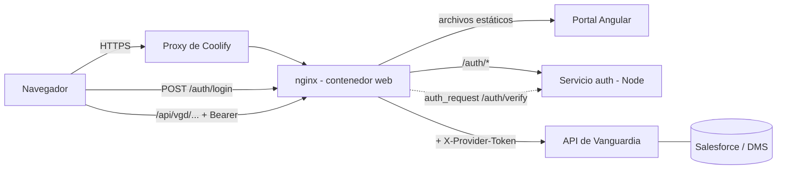
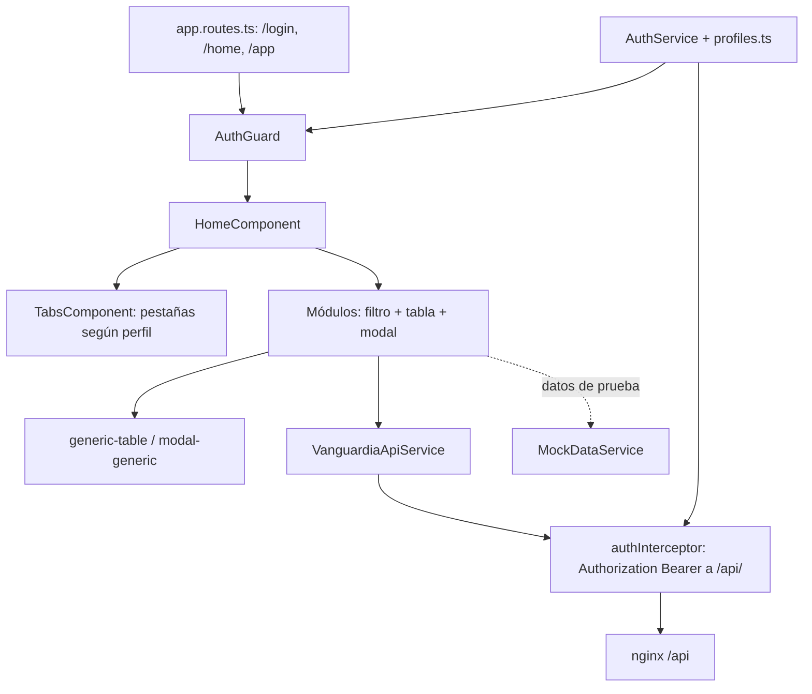
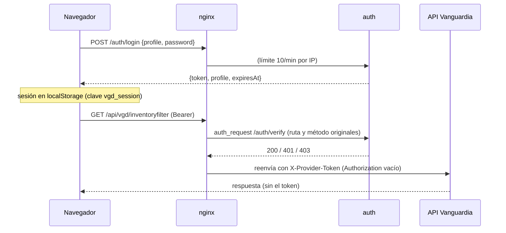

# Arquitectura

## Componentes

| Componente | Ubicación | Rol |
|---|---|---|
| Portal (SPA Angular) | `src/` | UI por módulo; todas las llamadas HTTP pasan por `VanguardiaApiService` |
| Servicio de acceso | `auth/` | Valida la contraseña del perfil, emite JWT y responde `/auth/verify` |
| Proxy nginx | `nginx/default.conf.template` | Sirve el portal, protege `/api` con `auth_request`, agrega el token de proveedor |
| API de Vanguardia | externa | Fuente de datos del DMS y de las tablas de Salesforce (`/vgd/...`) |
| Salesforce | externa | Destino de las integraciones; el portal solo muestra su reflejo y reenvía |
| Coolify | externa | Orquesta el despliegue del compose |

## Diagrama general

## Capas del portal

## Autenticación y autorización

Reglas (de `auth/README.md` y `nginx/default.conf.template`):
- Dos perfiles compartidos: `crabi` (solo Crabi) y `sales_force` (todo menos Crabi). Sin usuario por persona.
- `/auth/verify` solo acepta rutas `/api/vgd/<recurso>` y métodos GET y PUT; PUT únicamente sobre `inventoryfilter`, `customerfilter`, `servicefilter`, `leadsfilter`, `invoice` y `orderscrabi`.
- CRABI llega solo a `orderscrabi` y `agenciesfilter`; SALES FORCE a todo menos `orderscrabi`.
- Fallos de login: 429 tras 5 intentos en 15 min por IP, tope de 30 por perfil; nginx limita `/auth/login` a 10 por minuto.
- El 401 de nginx lleva `{"error":"session_expired"}`; solo ese cierra la sesión en el portal. Un 401 de la API no.
- Ocultar pestañas en el portal es control de pantalla; la autorización real está en `/auth/verify`. La regla vive duplicada en `core/auth/profiles.ts` y `auth/auth.js` (`canAccess`): si cambia una, cambia la otra.
- Limitación documentada: contraseñas compartidas y sesión en `localStorage` (un XSS podría robarla).

## Dependencias externas

- API de Vanguardia (por defecto `https://apisvanguardia.com:400`, configurable con `API_UPSTREAM`); nginx verifica su certificado TLS.
- Salesforce: acceso indirecto vía la API (el portal genera enlaces con `components/shared/salesforce-link.ts`).
- Coolify y GitHub (CI, PRs).

## Datos de prueba

La pestaña "Integración SF" usa `MockDataService` con datos **inventados** (`honda_orders`, `honda_leads`, `honda_services`, `honda_inventory`, generados en `services/mock-data/salesforce-honda.mock.ts`). No consume API real. Honda SF y Crabi sí usan la API real.

## Por confirmar

- Cómo se estructura `angular.json` / referencia a `proxy.conf.js` (no revisado).
- Si la ruta `/app` (hijos vacíos en `app.routes.ts`) se usa realmente; el portal opera en `/home`.
