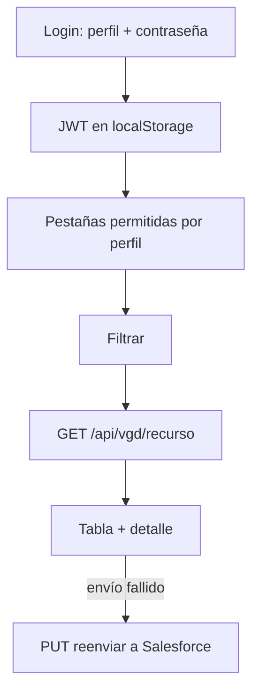

# Workflows, CI/CD y despliegue

## Flujos de negocio

Todos los módulos consultan la API de Vanguardia y muestran una tabla con filtros, paginación y detalle en modal; hay exportación a Excel (dependencia `xlsx`; módulos exactos **Por confirmar**).

| Pestaña (id) | Contenido | Escritura |
|---|---|---|
| Órdenes (`orders`) | Facturas (`invoice`) | PUT: reenvío a Salesforce |
| Inventario (`inventory`) | `inventoryfilter` | PUT |
| Validar demos (`demos`) | Revisa una lista de VIN contra inventario | Reenvío de registros |
| Servicios (`services`) | `servicefilter` | PUT |
| Clientes (`clients`) | `customerfilter` | PUT |
| Leads (`leads`) | `leadsfilter` | PUT |
| DWH (`dwh`) | `dwh` | No |
| Crabi (`crabi`) | `orderscrabi` | PUT: marcar reenvío (`isSend=0`) |
| Integración SF (`salesforce`) | Datos de prueba inventados | No |
| Honda SF (`hondasf`) | Siete tablas `portalhonda*` | No (solo lectura) |

### Reglas de negocio documentadas en el código

- Reenviar a Salesforce solo se habilita cuando el envío falló (`sendedSalesForce=1` e `insertCorrect=0`); es una escritura real.
- Crabi no tiene POST ni DELETE y no deben agregarse.
- Honda SF muestra solo Acura: `lockedFilters` en `honda-sf.catalog.ts` (`brand=ACURA`; Clientes por `dealer_id=2003`).
- Validar demos: hasta 200 VIN por corrida (`MAX_VINS`); separa por saltos de línea, comas, punto y coma o espacios, pasa a mayúsculas y descarta repetidos; resultado por VIN: `demo`, `not_demo`, `not_found`, `error`; una unidad es demo cuando `typeDescription` del inventario es `demo`.
- La API compara exacto, ignora parámetros desconocidos, topa `perpage` en 1000 y un parámetro vacío devuelve 0 filas.

## CI (`.github/workflows/ci.yml`)

Se ejecuta en `push` a `main` y en `pull_request` hacia `main`; cancela ejecuciones previas del mismo ref. Un solo job `verify` en ubuntu-latest:

1. Checkout, Node según `.nvmrc`, `npm ci`.
2. Instala Chrome con puppeteer (para Karma).
3. `npm audit --omit=dev` (informativo) y bloqueo solo en vulnerabilidades críticas (`xlsx` es alta y sin parche publicado, aceptado).
4. `npm test --prefix auth`.
5. `bash nginx/test-proxy.sh` (nginx real + auth real + API falsa).
6. `npm run typecheck`.
7. `npm run test:ci` (cobertura).
8. `npm run build`.
9. Sube el reporte `coverage/` como artefacto (7 días).

## Contenedores

- `Dockerfile` (raíz): etapa `node:22-bookworm-slim` hace `npm ci` y `npm run build`; etapa final `nginx:1.27-alpine` con la plantilla, los scripts de arranque y `dist/vex`. Healthcheck por `wget`.
- `auth/Dockerfile`: `node:22-alpine`, usuario `node`, puerto 3000, healthcheck `/auth/health`.
- `nginx/docker-entrypoint.d/05-logs.sh`: crea la carpeta de logs diarios y borra cada 6 h los de más de `LOG_RETENTION_DAYS` (15 por defecto).
- `nginx/docker-entrypoint.d/10-validate-env.sh`: valida `API_PROVIDER_TOKEN` y `API_UPSTREAM` antes de arrancar (rechaza caracteres que romperían la configuración).
- `docker-compose.yml`: servicios `web` (expone 80) y `auth` (expone 3000), volumen `portal-logs`; las variables obligatorias hacen fallar `docker compose` si faltan.

## Despliegue

Según `CLAUDE.md`: Coolify despliega la app `integration_monitor` (compose) automáticamente al mezclar un PR a `main`. Las variables se cargan en Coolify.

## Flujo de trabajo de desarrollo

- Nunca push directo a `main`: rama corta, PR, CI en verde, merge con squash.
- `main` exige rama al día (`gh pr update-branch`).
- Commits en español con prefijo convencional (`feat(modulo): ...`).
- `bin/vgd publish` abre o reutiliza el PR de la rama actual (opciones `--title`, `--body`, `--dry-run`, `--yes`, `--merge`); no corre en `main` ni con cambios sin commit. No llama a Coolify.
- Logs de acceso de nginx: un archivo diario en el volumen `portal-logs`, 15 días; no registran `Authorization` ni el token.

## Por confirmar

- Configuración exacta de Coolify (dominio, ramas, webhooks): solo consta en `CLAUDE.md`, no en el repositorio.
- Si las protecciones de rama de `main` descritas en `CLAUDE.md` siguen vigentes.
